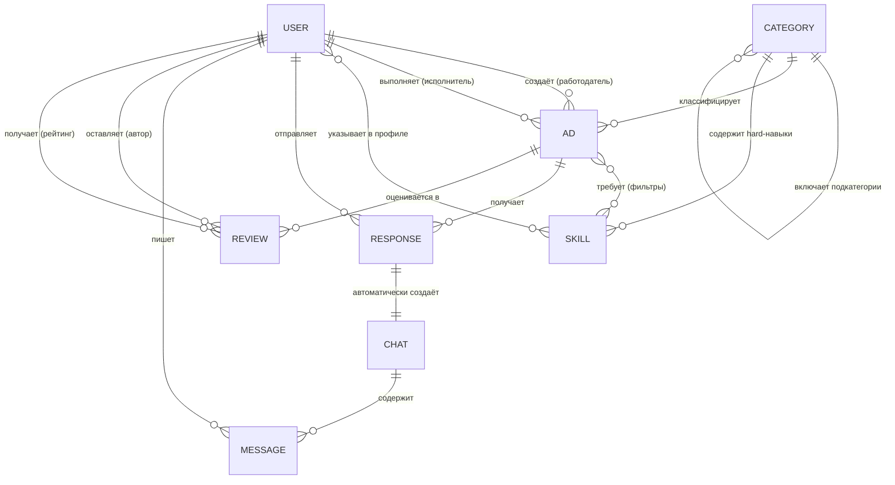

# Концептуальная схема базы данных

## Назначение этапа

Концептуальная (инфологическая) модель описывает ключевые объекты предметной области платформы **TheJobTree**, их смысловые характеристики и взаимосвязи без привязки к конкретной СУБД и физическим типам данных.

Платформа объединяет формат доски объявлений и сервиса поиска подработки: любой зарегистрированный пользователь может как публиковать объявления о работе, так и откликаться на предложения других пользователей. Взаимодействие сторон строится через отклики с автоматическим созданием чата, фильтрацию объявлений по софт-скиллам и систему взаимных отзывов.

## Основные сущности предметной области

В рамках концептуального проектирования выделены 8 базовых сущностей:

1. **Пользователь (User)** — зарегистрированный участник платформы с единым профилем. Может выступать в роли работодателя (размещать объявления) и в роли соискателя (откликаться и выполнять заказы). Характеризуется именем, фамилией, контактными данными (email, телефон), городом, аватаром, описанием профиля и датой регистрации.
2. **Категория (Category)** — раздел рубрикатора услуг и подработки (например, «Ремонт и быт», «IT и диджитал», «Доставка и логистика»). Поддерживает иерархию родительских категорий и подкатегорий («Ремонт и быт» → «Электромонтаж», «Сантехника», «Клининг»).
3. **Навык / Софт-скилл (Skill)** — характеристика требований объявления и компетенций пользователя. Подразделяется на гибкие навыки (`soft` — пунктуальность, коммуникабельность, ответственность и др.), используемые как основные фильтры в ленте объявлений, и профильные навыки (`hard`), привязанные к категориям работ.
4. **Объявление (Ad)** — публикация работодателя о поиске исполнителя на разовую задачу или подработку. Содержит заголовок, описание, бюджет, город, признак удалённого формата, желаемый срок выполнения и статус жизненного цикла (`активно`, `в работе`, `выполнено`, `отменено`).
5. **Отклик (Response)** — предложение соискателя выполнить конкретное объявление. Содержит сопроводительное письмо, предлагаемый бюджет (может отличаться от указанного в объявлении), дату подачи и статус рассмотрения (`ожидает`, `принят`, `отклонен`).
6. **Чат (Chat)** — выделенный канал переписки между работодателем и соискателем, создаваемый автоматически при подаче отклика для обсуждения деталей сотрудничества.
7. **Сообщение (Message)** — отдельная реплика в рамках чата, содержащая текст, автора, дату и время отправки, а также статус прочтения.
8. **Отзыв (Review)** — взаимная оценка участников после завершения работы по объявлению. Включает оценку по 5-балльной шкале, текстовый комментарий и дату публикации. На основе отзывов формируется репутация пользователя в его профиле.

## Связи между сущностями

| Связь | Тип (кардинальность) | Смысловое описание |
| :--- | :---: | :--- |
| Пользователь — Объявление (создаёт) | `1 : M` | Один пользователь-работодатель может разместить множество объявлений; каждое объявление имеет одного автора. |
| Пользователь — Объявление (выполняет) | `1 : M` | Один пользователь-соискатель может выполнить множество объявлений; у каждого объявления может быть не более одного назначенного исполнителя (до выбора — `NULL`). |
| Категория — Категория (иерархия) | `1 : M` | Родительская категория может включать несколько подкатегорий. |
| Категория — Объявление | `1 : M` | К одной категории относится множество объявлений; каждое объявление принадлежит одной категории. |
| Категория — Навык | `1 : M` | Одна категория может содержать множество профильных навыков; универсальные софт-скиллы к конкретной категории не привязаны. |
| Объявление — Навык | `M : N` | Одно объявление может требовать несколько софт-скиллов и навыков, а один навык может встречаться во множестве объявлений. |
| Пользователь — Навык | `M : N` | Один пользователь может указывать в профиле несколько навыков, а одним навыком может обладать множество пользователей. |
| Объявление — Отклик | `1 : M` | На одно объявление может поступить множество откликов от разных соискателей; каждый отклик относится к одному объявлению. |
| Пользователь — Отклик | `1 : M` | Один пользователь может отправить множество откликов на разные объявления; каждый отклик имеет одного автора-соискателя. |
| Отклик — Чат | `1 : 1` | Каждый отклик автоматически порождает ровно один чат между работодателем и соискателем. |
| Чат — Сообщение | `1 : M` | В одном чате хранится множество сообщений; каждое сообщение принадлежит одному чату. |
| Пользователь — Сообщение | `1 : M` | Пользователь может отправить множество сообщений в разных чатах; у каждого сообщения один отправитель. |
| Объявление — Отзыв | `1 : M` | По одному завершённому объявлению стороны могут оставить взаимные отзывы (работодатель об исполнителе и исполнитель о работодателе). |
| Пользователь — Отзыв | `1 : M` | Один пользователь может как написать множество отзывов (автор), так и получить множество отзывов (получатель). |

## ER-диаграмма (концептуальный уровень)

## Ключевые бизнес-правила

* Пользователь не может откликнуться на собственное объявление и не может быть назначен исполнителем своего же объявления.
* Один соискатель может отправить на конкретное объявление только один отклик.
* Чат между работодателем и соискателем не существует сам по себе — он создаётся строго в момент подачи отклика.
* При выборе исполнителя его отклик получает статус `принят`, все остальные ожидающие отклики по этому объявлению автоматически переводятся в статус `отклонен`, а само объявление переходит в статус `в работе`.
* Пользователь не может оставить отзыв самому себе; в рамках одного объявления одна сторона может оценить другую только один раз.