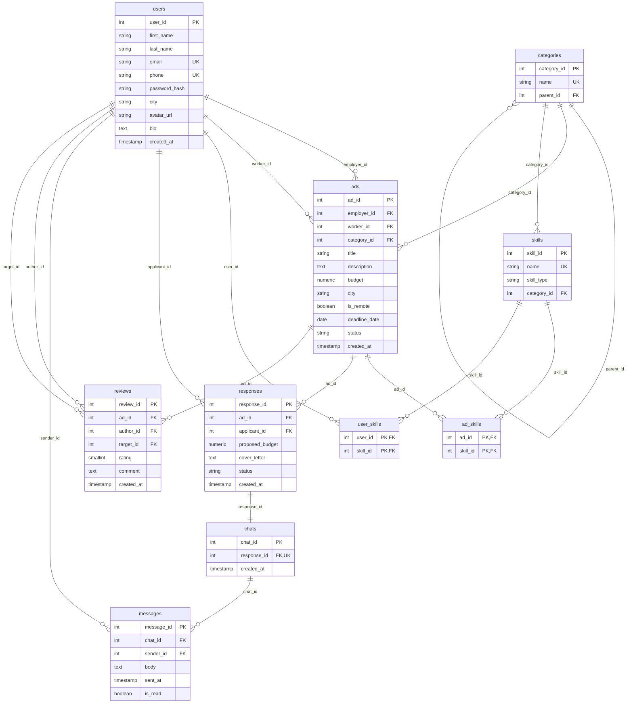

# Логическая схема базы данных

## Переход от концептуальной модели к реляционной

При преобразовании концептуальной ER-модели в логическую реляционную схему выполнены следующие шаги:

1. **Раскрытие связей «многие-ко-многим» (`M:N`):**
   * связь между `ads` и `skills` (требуемые софт-скиллы и навыки для фильтрации объявлений) вынесена в ассоциативную таблицу **`ad_skills`** с составным первичным ключом `(ad_id, skill_id)`;
   * связь между `users` и `skills` (навыки в профиле пользователя) вынесена в ассоциативную таблицу **`user_skills`** с составным первичным ключом `(user_id, skill_id)`.
2. **Отказ от избыточного дублирования в чатах:** таблица `chats` связана с `responses` отношением `1:1` через уникальный внешний ключ `response_id`. Поскольку в `responses` уже хранятся ссылки на объявление (`ad_id`) и соискателя (`applicant_id`), а в `ads` — ссылка на работодателя (`employer_id`), дублировать эти поля в `chats` не требуется.
3. **Исключение вычисляемых атрибутов:** средний рейтинг пользователя и количество полученных отзывов не хранятся в таблице `users`, а вычисляются динамически на основе таблицы `reviews` (через представление `user_ratings`). Это исключает рассинхронизацию данных и нарушения третьей нормальной формы.

В итоговой логической схеме определено **10 реляционных отношений**.

## Диаграмма логической модели

## Описание реляционных отношений

### 1. `users` (Пользователи)
| Атрибут | Ключ | Обязательность | Описание и ограничения |
| :--- | :--- | :---: | :--- |
| `user_id` | PK | NOT NULL | Уникальный идентификатор пользователя |
| `first_name` | — | NOT NULL | Имя пользователя |
| `last_name` | — | NOT NULL | Фамилия пользователя |
| `email` | UK | NOT NULL | Электронная почта (уникальна) |
| `phone` | UK | NOT NULL | Номер телефона (уникален) |
| `password_hash` | — | NOT NULL | Хеш пароля для авторизации |
| `city` | — | NOT NULL | Город проживания |
| `avatar_url` | — | NULL | Путь к аватару профиля (есть значение по умолчанию) |
| `bio` | — | NULL | Текстовое описание «О себе» в профиле |
| `created_at` | — | NOT NULL | Дата и время регистрации |

### 2. `categories` (Категории объявлений)
| Атрибут | Ключ | Обязательность | Описание и ограничения |
| :--- | :--- | :---: | :--- |
| `category_id` | PK | NOT NULL | Идентификатор категории |
| `name` | UK | NOT NULL | Наименование категории (уникально) |
| `parent_id` | FK → `categories(category_id)` | NULL | Ссылка на родительскую категорию (`NULL` для верхнего уровня) |

### 3. `skills` (Софт-скиллы и навыки)
| Атрибут | Ключ | Обязательность | Описание и ограничения |
| :--- | :--- | :---: | :--- |
| `skill_id` | PK | NOT NULL | Идентификатор навыка |
| `name` | UK | NOT NULL | Название навыка (уникально) |
| `skill_type` | — | NOT NULL | Тип навыка: `'soft'` (гибкий) или `'hard'` (профильный) |
| `category_id` | FK → `categories(category_id)` | NULL | Ссылка на категорию (`NULL` для общих софт-скиллов) |

### 4. `ads` (Объявления о работе и подработке)
| Атрибут | Ключ | Обязательность | Описание и ограничения |
| :--- | :--- | :---: | :--- |
| `ad_id` | PK | NOT NULL | Идентификатор объявления |
| `employer_id` | FK → `users(user_id)` | NOT NULL | Автор объявления (работодатель) |
| `worker_id` | FK → `users(user_id)` | NULL | Назначенный исполнитель (`NULL`, пока объявление активно; `employer_id <> worker_id`) |
| `category_id` | FK → `categories(category_id)` | NOT NULL | Категория работы |
| `title` | — | NOT NULL | Заголовок объявления |
| `description` | — | NOT NULL | Подробное описание задачи и условий |
| `budget` | — | NOT NULL | Предлагаемая оплата (`budget > 0`) |
| `city` | — | NOT NULL | Город выполнения работы |
| `is_remote` | — | NOT NULL | Признак удалённого формата (`FALSE` по умолчанию) |
| `deadline_date` | — | NULL | Желаемая дата завершения |
| `status` | — | NOT NULL | Статус: `'активно'`, `'в работе'`, `'выполнено'`, `'отменено'` |
| `created_at` | — | NOT NULL | Дата и время публикации |

### 5. `ad_skills` (Требуемые навыки объявления)
| Атрибут | Ключ | Обязательность | Описание и ограничения |
| :--- | :--- | :---: | :--- |
| `ad_id` | PK, FK → `ads(ad_id)` | NOT NULL | Ссылка на объявление |
| `skill_id` | PK, FK → `skills(skill_id)` | NOT NULL | Ссылка на требуемый софт-скилл или навык |

### 6. `user_skills` (Навыки пользователя)
| Атрибут | Ключ | Обязательность | Описание и ограничения |
| :--- | :--- | :---: | :--- |
| `user_id` | PK, FK → `users(user_id)` | NOT NULL | Ссылка на пользователя |
| `skill_id` | PK, FK → `skills(skill_id)` | NOT NULL | Ссылка на навык в профиле пользователя |

### 7. `responses` (Отклики)
| Атрибут | Ключ | Обязательность | Описание и ограничения |
| :--- | :--- | :---: | :--- |
| `response_id` | PK | NOT NULL | Идентификатор отклика |
| `ad_id` | FK → `ads(ad_id)`, UK* | NOT NULL | Объявление, на которое подан отклик |
| `applicant_id` | FK → `users(user_id)`, UK* | NOT NULL | Пользователь-соискатель (`UNIQUE(ad_id, applicant_id)`) |
| `proposed_budget` | — | NULL | Предлагаемая соискателем сумма (`> 0`, если указана) |
| `cover_letter` | — | NOT NULL | Сопроводительное сообщение |
| `status` | — | NOT NULL | Статус отклика: `'ожидает'`, `'принят'`, `'отклонен'` |
| `created_at` | — | NOT NULL | Дата и время подачи отклика |

### 8. `chats` (Чаты по откликам)
| Атрибут | Ключ | Обязательность | Описание и ограничения |
| :--- | :--- | :---: | :--- |
| `chat_id` | PK | NOT NULL | Идентификатор чата |
| `response_id` | FK → `responses(response_id)`, UK | NOT NULL | Уникальная ссылка на отклик (обеспечивает связь `1:1`) |
| `created_at` | — | NOT NULL | Дата и время открытия чата |

### 9. `messages` (Сообщения)
| Атрибут | Ключ | Обязательность | Описание и ограничения |
| :--- | :--- | :---: | :--- |
| `message_id` | PK | NOT NULL | Идентификатор сообщения |
| `chat_id` | FK → `chats(chat_id)` | NOT NULL | Чат, к которому относится сообщение |
| `sender_id` | FK → `users(user_id)` | NOT NULL | Отправитель сообщения |
| `body` | — | NOT NULL | Текст сообщения (не может быть пустым или состоять из пробелов) |
| `sent_at` | — | NOT NULL | Дата и время отправки |
| `is_read` | — | NOT NULL | Признак прочтения (`FALSE` по умолчанию) |

### 10. `reviews` (Отзывы)
| Атрибут | Ключ | Обязательность | Описание и ограничения |
| :--- | :--- | :---: | :--- |
| `review_id` | PK | NOT NULL | Идентификатор отзыва |
| `ad_id` | FK → `ads(ad_id)`, UK* | NOT NULL | Объявление, по итогам которого оставлен отзыв |
| `author_id` | FK → `users(user_id)`, UK* | NOT NULL | Автор отзыва |
| `target_id` | FK → `users(user_id)`, UK* | NOT NULL | Получатель отзыва (`author_id <> target_id`, `UNIQUE(ad_id, author_id, target_id)`) |
| `rating` | — | NOT NULL | Оценка от `1` до `5` |
| `comment` | — | NOT NULL | Текст отзыва |
| `created_at` | — | NOT NULL | Дата и время публикации |

## Нормализация базы данных (до 3НФ)

Все 10 отношений спроектированной модели приведены к **третьей нормальной форме (3НФ)**:

* **Первая нормальная форма (1НФ):** все атрибуты всех таблиц атомарны, повторяющиеся группы и списки значений в одной ячейке отсутствуют. Перечни софт-скиллов и навыков вынесены в отдельные таблицы `ad_skills` и `user_skills`, имя и фамилия разделены на `first_name` и `last_name`.
* **Вторая нормальная форма (2НФ):** все таблицы соответствуют 1НФ, а каждый неключевой атрибут полностью функционально зависит от первичного ключа. В таблицах с простым первичным ключом (8 из 10 таблиц) частичная зависимость невозможна по определению; в таблицах с составным первичным ключом (`ad_skills`, `user_skills`) неключевые атрибуты отсутствуют.
* **Третья нормальная форма (3НФ):** все таблицы находятся во 2НФ, и транзитивные зависимости между неключевыми атрибутами устранены:
  * основные функциональные зависимости имеют вид `PK → неключевые атрибуты` (например, `ad_id → {employer_id, worker_id, category_id, title, description, budget, city, is_remote, deadline_date, status, created_at}`);
  * в `chats` отсутствуют поля `ad_id`, `employer_id` и `applicant_id`, которые транзитивно зависели бы от `response_id`;
  * средний рейтинг пользователя не хранится в `users`, а агрегируется в представлении `user_ratings`;
  * названия категорий и навыков хранятся исключительно в справочниках `categories` и `skills`.

## Ограничения целостности

1. **Целостность сущностей:** каждая таблица имеет уникальный первичный ключ (`PK`), не принимающий значение `NULL`.
2. **Ссылочная целостность:** все внешние ключи (`FK`) гарантируют, что нельзя создать объявление без существующего работодателя и категории, отклик — без объявления и пользователя, чат — без отклика, сообщение — без чата, а отзыв — без объявления и участников сделки.
3. **Доменные ограничения (`CHECK`):**
   * `ads.budget > 0` и `responses.proposed_budget > 0`;
   * `reviews.rating BETWEEN 1 AND 5`;
   * допустимые значения статусов (`ads.status`, `responses.status`) и типа навыка (`skills.skill_type`);
   * запрет пустых сообщений (`LENGTH(TRIM(body)) > 0`).
4. **Ограничения уникальности и бизнес-логики:**
   * уникальные `users.email`, `users.phone`, `categories.name`, `skills.name`;
   * один отклик от пользователя на одно объявление (`UNIQUE(ad_id, applicant_id)`);
   * один чат на один отклик (`UNIQUE(response_id)`);
   * один отзыв от автора конкретному получателю по одному объявлению (`UNIQUE(ad_id, author_id, target_id)`);
   * запрет на самоназначение (`employer_id <> worker_id`), самооценку (`author_id <> target_id`) и отклик на своё объявление.